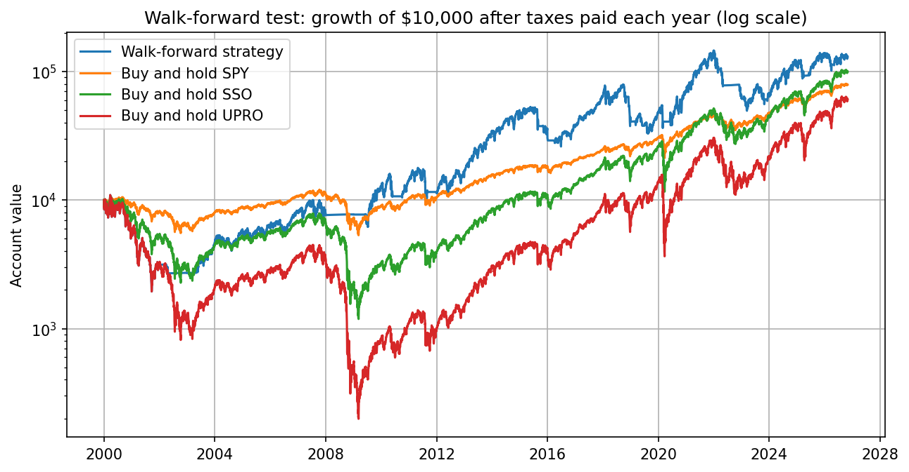
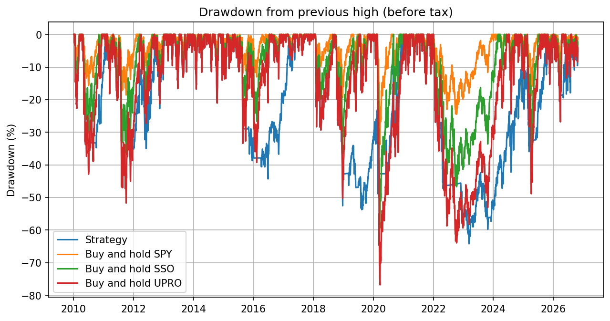

# Does Timing Beta Beat Buy and Hold After Taxes?

Robert Miller

November 2026. Data through October 29, 2026.

## Abstract

This project tests whether an investor who checks once a month in a regular taxable account can beat buying and holding the S&P 500 by changing how much market exposure (beta) they hold. I test three versions: a trend filter with volatility targeting on SPY, a rule that moves between SPY, sector ETFs, the 2x fund SSO and T-bills depending on the trend, and trend filters and leverage rules from published research applied to the 3x fund UPRO. All results include trading costs, next-day execution, and federal taxes with tax lots and the wash sale rule. The best rule held 3x while SPY was above its 200-day moving average and T-bills otherwise. In a walk-forward test starting in 2000, it turned $10,000 into $121,387 after tax, compared to $69,793 for SPY and $86,467 for SSO, although it fell 82% along the way. Its lead over SPY is not statistically significant (t = 1.66), and it has trailed leveraged buy and hold since the real UPRO started trading in 2009. Most of the gain comes from sitting out the 2000-2002 and 2008 bear markets.

Keywords: market timing, leveraged ETFs, trend following, conditional beta, volatility targeting, after-tax backtesting

JEL classification: G11, G14, G17

## 1. Introduction

Buying and holding the S&P 500 is hard to beat, but it also means sitting through every crash fully invested. The idea I wanted to test is whether holding more beta while the market trends up, and less or none when it doesn't, leaves an investor with more money at the end. Leveraged ETFs also make it easy to go beyond 1x, since SSO and UPRO let anyone with a brokerage account hold 2x or 3x the market. That adds a second question on top of when to be invested, which is how much leverage to use.

Backtests of this idea often leave out things a real investor has to deal with. For example, many trade at the same close that produced the signal or ignore taxes, and some pick their settings using the same years they report results for. I tried to account for these, specifically for someone like me who would check once a month and hold everything in a taxable account.

The project has three versions. v1 holds only SPY and T-bills and uses a trend filter with volatility targeting to set the SPY weight. v2 adds SSO and the nine sector ETFs, based on research showing that high beta stocks beat low beta stocks in up markets. v3 drops the sectors and adds UPRO, and every rule in it comes from a published paper. Each version is tested on a fixed train/test split, and v2 and v3 also get a walk-forward test that re-picks the settings every January using only earlier years.

The short answer is no, at least not reliably. v3 beat buy and hold SPY and SSO from 2000 and from 2005, but most of that came from being out of the market during long bear markets, and mostly in years before UPRO existed, when it had to be rebuilt from SPY. Since 2010, v3 has trailed buy and hold SSO and UPRO.



*Figure 1: Growth of $10,000 from 2000 for the v3 walk-forward strategy and buy and hold SPY, SSO and UPRO, after the federal taxes paid each year (log scale). The strategy re-picks its setting every January using only earlier years.*

The rest of this README starts with background on the ETFs and the papers the rules come from (Section 2), then goes through the data (Section 3) and how the rules, costs, taxes and tests work (Section 4). Section 5 has the main results, Section 6 has the robustness checks, and Section 7 has the conclusion and limitations.

## 2. Background and related literature

### 2.1 What beta means

Beta measures how much an asset tends to move when the market moves. It is estimated as

$$\beta = \frac{\text{Cov}(r_i, r_m)}{\text{Var}(r_m)} \qquad (1)$$

where $r_i$ is the asset's daily return and $r_m$ is the market's (SPY's) daily return over the same window. A beta of 1 means the asset moves with the market about one for one, so SPY has a beta of 1 by definition. For example, a sector with a beta of 1.3 has historically moved about 1.3% for every 1% move in the S&P 500, while T-bills have a beta of about 0. SSO and UPRO are built to have daily betas of about 2 and 3. Timing beta in this project means changing that number over time, holding more of it when the trend is up and less when it's down, instead of keeping it at 1 like buy and hold.

### 2.2 The ETFs

Table 1 lists every ticker used in the project and what it's used for.

*Table 1: Tickers used in the project*

| Ticker | What it is | Started | Expense ratio used | Role here |
|---|---|---|---|---|
| SPY | SPDR S&P 500 ETF. Tracks the S&P 500 (about 500 of the largest US companies, weighted by size). | Jan 1993 | 0.0945% | The benchmark, and 1x exposure |
| SSO | ProShares Ultra S&P 500. Aims for 2x the S&P 500's daily return. | Jun 2006 | 0.89% | 2x exposure |
| UPRO | ProShares UltraPro S&P 500. Aims for 3x the S&P 500's daily return. | Jun 2009 | 0.91% | 3x exposure |
| SGOV | iShares 0-3 Month Treasury Bond ETF. Holds very short-term T-bills. | 2020 | 0.09% | Where the cash sits (modeled as the 3-month T-bill rate minus SGOV's fee) |
| XLB, XLE, XLF, XLI, XLK, XLP, XLU, XLV, XLY | The nine original Select Sector SPDRs: materials, energy, financials, industrials, technology, consumer staples, utilities, health care and consumer discretionary. | Dec 1998 | about 0.08% | v2 ranks these by beta and holds the highest (or lowest) beta sectors |
| ^VIX | CBOE Volatility Index. The market's own estimate of S&P 500 volatility over the next 30 days, based on options prices. | 1990 | n/a | One of v3's ways to size leverage |
| ^N225, ^GDAXI | Japan's Nikkei 225 and Germany's DAX stock indexes. | n/a | n/a | Only used to test v3's rule outside the US |

Notes: Expense ratios for the ETFs are already included in their Yahoo Finance prices. They are only applied directly when SSO and UPRO are rebuilt before they existed (Section 3.2) and to the cash return.

### 2.3 Why leveraged ETFs don't just return 2x or 3x

SSO and UPRO reset their leverage every day, so they deliver 2x or 3x of each day's return. Over a month or a year, the result can be quite different from 2x or 3x. When the market moves in one direction for a while, the daily reset helps slightly, but when it moves back and forth, the reset costs money. For example, say the S&P 500 is up 10% one day and down 10% the next. That leaves it down 1%, since 1.10 x 0.90 = 0.99. A 3x fund would be up 30% and then down 30%, and 1.30 x 0.70 = 0.91, so it ends down 9% instead of the 3% you might expect. This is usually called volatility decay, and Cheng and Madhavan (2009) work through it in detail. It shows up in recent data too. Bianchi and Goldberg (2026) point out that the S&P 500 was roughly flat over 2022-2023 while UPRO lost 28%. This is the main reason v3 uses a trend filter, since the goal is to hold leverage only while there is a trend.

### 2.4 Beta and conditional beta

v2 is based mostly on Lakonishok and Shapiro (1984). Across NYSE stocks from 1962-1980, they found that beta alone did not explain returns, but high beta stocks did better than low beta stocks in up markets and worse in down markets. Pettengill, Sundaram and Mathur (1995) built a formal test around this, and Xiao (2016) for the US and Elsas, El-Shaer and Theissen (2003) for Germany found the same pattern with it. So beta seems to pay off mainly when you know which way the market is going. The problem is that their test splits months by the market's return in that same month, which nobody knows ahead of time. The question for v2 is whether a trend signal that is known ahead of time can stand in for it.

A few other papers shaped the setup. Zenner et al. (2008) put the market risk premium at about 5-7% a year, so sitting in cash has a real cost. Genc, Moench and Pazarbasi (2025) found that fund managers move into high beta stocks when rates rise, which raises raw returns but not risk-adjusted ones. Hsu, Kalesnik and Li (2012) found that equal weighting beat the S&P 500 from 1967-2010, mostly through value and small-cap tilts, which Campbell and Vuolteenaho's (2003) "bad beta, good beta" paper helps explain. For that reason, v2 is also compared against an equal weight sector portfolio.

### 2.5 Trend following and volatility management

The trend filter in v3 comes from Gayed and Bilello (2016), who held a leveraged S&P 500 only while it was above its 200-day moving average and moved to T-bills otherwise. From 1928-2015, that beat both regular and leveraged buy and hold. Faber (2007) uses the same idea with a 10-month average. On how often to check, Clare et al. (2013) found that for the S&P 500, checking at month end did about as well as checking daily, and that stop losses did not help.

For position size, Moreira and Muir (2017) and Harvey et al. (2018) found that scaling exposure by 1/variance raised the market's Sharpe ratio. This is close to the Kelly rule in Rotando and Thorp (1992), where leverage equals the risk premium divided by the variance. v1's volatility targeting and v3's Kelly-style sizing both come from this idea.

On the other hand, two of the papers read more like warnings. Cederburg et al. (2020) found that volatility management usually did not beat buy and hold out of sample, and Zakamulin (2014) found that moving average timing mostly wins in a few large bear markets and lags in bull markets once it is tested out of sample with realistic costs. My results end up agreeing with both.

## 3. Data

### 3.1 Sources

`get_data.py` downloads daily prices from Yahoo Finance using `yfinance` for every ticker in Table 1 except SGOV, which only starts in 2020. Cash is modeled with the 3-month T-bill rate (DTB3) from FRED instead, which doesn't need an API key. I use both the Adj Close and Close columns from Yahoo. Adj Close includes reinvested dividends, so its percent change is the total return, and Close is the price only. The gap between the two on a given day is the dividend, which the tax model needs. The sample runs from January 1993 to October 29, 2026.

### 3.2 Rebuilding SSO and UPRO before they existed

SSO did not exist before June 2006 and UPRO did not exist before June 2009, so for those years I rebuild them from SPY. The daily return of a fund with leverage $L$ is

$$r_{L,t} = L \cdot r_{SPY,t} - (L-1) \cdot r_{f,t} - \frac{(L-1) \cdot s + f}{252} \qquad (2)$$

where $r_{f,t}$ is the daily T-bill return, $s$ is the extra borrowing spread, and $f$ is the fund's expense ratio. I fit the spread ($s$ = 0.7% for SSO and 0.6% for UPRO) so the rebuilt fund grows at the same rate as the real one over the years where both exist. The rebuilt and real daily returns have correlations of 0.996 (SSO) and 0.998 (UPRO).

## 4. Methodology

### 4.1 Strategy rules

Every version computes its signal at the month end close. For v1, if SPY's total return index is above its N-month average, the trend is up and the strategy holds SPY, and if not it moves to T-bills (or only partly, using an "off weight"). In addition, the SPY weight is scaled by volatility,

$$w_t = \min\left(1, \frac{\sigma^*}{\hat{\sigma}_t}\right) \qquad (3)$$

where $\sigma^*$ is the target volatility and $\hat{\sigma}_t$ is SPY's recent realized volatility.

v2 uses the same kind of trend signal (8, 10 or 12 months). In an uptrend it takes on more beta, either by holding 100% SPY, the 2-4 highest beta sector ETFs, or a SPY/SSO mix that gets to a beta of 1.5 or 2. In a downtrend it takes on less, so it either moves to T-bills or holds the 3 lowest beta sectors. Sector betas are measured over the last 6 or 12 months.

v3 holds SPY, SSO, UPRO and T-bills, so leverage can be anywhere from 0 to 3x. The trend filter is either the 200-day average, the 10-month average, or none. Leverage is either a fixed 2x or 3x, or a Kelly-style rule,

$$L_t = \min\left(3, k \cdot \frac{\mu}{\hat{\sigma}_t^2}\right) \qquad (4)$$

with $k$ = 0.5 or 1, a risk premium $\mu$ of 6% (the middle of Zenner et al.'s range), and volatility from either the last 21 days or the VIX. Table 2 lists every setting that was tested.

*Table 2: Settings tested in each version*

| Version | Parameters | Combinations |
|---|---|---|
| v1 | Trend length 6, 8, 10 or 12 months; volatility window 21 or 63 days; target volatility 10%, 12.5%, 15% or 20%; off weight 0, 25% or 50% | 96 |
| v2 | Trend length 8, 10 or 12 months; uptrend holding (SPY, top 2/3/4 beta sectors, or 1.5x/2x SPY/SSO); downtrend holding (T-bills or 3 lowest beta sectors); beta window 6 or 12 months; optional 20% volatility cap | 126 |
| v3 | Trend filter (none, 200-day, 10-month); sizing (fixed 2x/3x, Kelly 0.5/1 with realized or VIX volatility); check frequency (monthly, weekly, daily) | 42 |

Notes: The 10-month filter in v3 is only tested monthly. The beta window in v2 only affects results when sectors are held. I also tried 13 settings in a technical indicator version that I dropped, so the project has about 277 trials in total.

### 4.2 Execution and trading costs

The trade goes in at the next day's close after the signal, since you can't trade at a close you haven't seen yet. There's no commission, but I charge 5 basis points of spread and slippage on every dollar traded, and nothing trades unless a holding is at least 5% off its target. The account starts with $10,000, and cash earns the T-bill rate minus SGOV's 0.09% fee.

### 4.3 Taxes

The account is taxable, and I only model federal tax. Every purchase is its own tax lot, and the oldest shares are sold first (FIFO). Short-term gains, T-bill interest and SSO/UPRO payouts are taxed at 22%, since leveraged funds mostly pay out short-term gains. Long-term gains and SPY/sector dividends are taxed at 15%. Losses offset gains and carry forward, the wash sale rule is applied, and the tax bill comes out of the account every December. I don't credit the $3,000 deduction against other income, since that saving happens outside the account. The results are shown after tax and sold at the end, which means the last step also pays the tax on any gains that haven't been sold yet. I think that's the fairer comparison, since buy and hold always carries a large gain that hasn't been taxed yet.

### 4.4 Testing design

For the fixed split, settings are picked on 2000-2009 by after-tax growth, then locked in and tested on 2010 to now. v1 uses 1995-2009 and ranks by Sharpe ratio instead, because ranking by growth would just pick whatever holds the most SPY. For the walk-forward, every setting is scored each January on all the years before it, and the best one is traded for the next 12 months. v3's walk-forward starts in 2000 (scored from 1994) so it has to get through the dot com crash, while v2's starts in 2005 because the sector ETFs only go back to December 1998.

## 5. Results

### 5.1 Main results

Table 3 shows the main results. From 2005 (where v2's walk-forward starts), v2 made 10.8% a year after tax and v3 made 14.6%, compared to 9.9% for SPY, 13.7% for SSO and 14.8% for UPRO.

*Table 3: Ending value of $10,000 after federal taxes, sold at the end*

| | 2010-now (fixed split) | 2000-now (walk-forward) | Max drawdown since 2000 |
|---|---|---|---|
| v1 - trend + vol targeting | $36,604 (8.0%/yr) | - | - |
| v2 - conditional beta | $48,696 (9.9%/yr) | - | - |
| v3 - 200 day trend, 3x | $96,681 (14.5%/yr) | $121,387 (9.8%/yr) | -82% |
| Buy and hold SPY | $76,769 (12.9%/yr) | $69,793 (7.5%/yr) | -55% |
| Buy and hold SSO (2x) | $261,801 (21.5%/yr) | $86,467 (8.4%/yr) | -89% |
| Buy and hold UPRO (3x) | $611,415 (27.8%/yr) | $53,118 (6.4%/yr) | -98% |

Notes: Fixed split settings were picked on 2000-2009 (1995-2009 for v1). Only v3 has a walk-forward from 2000. Drawdowns are from before-tax daily returns.

v1 lowered risk the way it was supposed to. From 2010 its max drawdown was about -21% vs -34% for SPY and its beta was 0.57, but its Sharpe ratio was also lower (0.65 vs 0.77), so the smoother ride did not make up for the lost return. v2's fixed split pick made 9.9% a year vs 12.9% for SPY, with a worse drawdown (-45% vs -34%).

The setting v3 picked holds 3x (100% UPRO) whenever SPY is above its 200-day moving average at month end, and 100% T-bills when it's below. From 2010 on it was at 3x about 84% of the time and in T-bills the rest, and it beat SSO in 8 of the 17 years before tax.



*Figure 2: Drawdown from the previous high since 2010 for v3 (fixed split setting) and buy and hold SPY, SSO and UPRO, before tax.*

### 5.2 Results by start year

Since a single start date can make any strategy look good or bad, Table 4 runs the same v3 walk-forward signals from different start years.

*Table 4: v3 walk-forward after-tax CAGR by start year*

| Start | v3 | SPY | SSO | UPRO | v3 max drawdown |
|---|---|---|---|---|---|
| 2000 | 9.8% | 7.5% | 8.4% | 6.4% | -82% |
| 2005 | 14.6% | 9.9% | 13.7% | 14.8% | -64% |
| 2008 | 15.6% | 10.3% | 14.6% | 15.6% | -64% |
| 2010 | 14.5% | 12.9% | 21.5% | 27.8% | -64% |
| 2015 | 9.6% | 12.3% | 19.3% | 23.6% | -64% |
| 2020 | 13.9% | 13.4% | 19.4% | 21.7% | -64% |

Notes: Same signals in every row, only the start date changes. Each row's taxes start from a new $10,000 account.

The lead shrinks with later start years and eventually reverses. From 2010, 2015 and 2020 the strategy trailed SSO, and from 2015 it also trailed SPY. The -82% from 2000 happened because scoring 1994-1999 picked plain 3x buy and hold for 2000 and 2001, right into the dot com crash, and it only switched to the trend filter in 2002.

### 5.3 Where the edge comes from

v3's gains are concentrated in bear markets. It was out of the market for most of 2000-2002 and 2008, which is when buy and hold leverage did the most damage. For example, from 2000-2009 buy and hold SSO lost about 11% a year after tax and UPRO lost about 22%. On the other hand, in bull markets with quick dips (most of 2010-2026), the filter often sold near the bottom and bought back higher, which shows up in Figure 2 in 2011, 2015-2016, late 2018, 2020 and 2022-2023. Zakamulin (2014) reports the same pattern for moving average timing in general.

### 5.4 The conditional beta test

To test the idea behind v2, each month I regressed the sectors' next-month returns on their beta over the previous 12 months. When I split months by whether SPY beat T-bills that month, high beta sectors did better in up months (t = 3.9 from 2010 on) and worse in down months (t = -4.9), which matches the papers. However, that split uses a return you don't know yet, and if betas stay about the same over time, it mostly comes out that way automatically. When I split by the trend signal known at the start of the month instead, the effect mostly disappeared (t = 0.06 in uptrends from 2010 on, -0.21 in training). This is also why v2's walk-forward never picked the high beta sectors and only used the low beta sectors for downtrends in 2024-2026.

## 6. Robustness

### 6.1 Rebuilt vs real UPRO

UPRO has only existed since June 25, 2009, so everything before that is rebuilt using equation (2). In the rebuilt years (2000 to June 2009), the strategy lost 3.5% a year before tax, compared to -3.0% for SPY, -14.8% for SSO and -27.7% for UPRO. Since UPRO started trading, it made 19.9% a year vs 14.8% for SPY, 24.4% for SSO and 31.8% for UPRO. This means all of v3's edge over leveraged buy and hold comes from years where UPRO had to be rebuilt, so the result depends heavily on how realistic the rebuilt UPRO is.

### 6.2 Statistical significance

Over 26 years, v3's average yearly lead was about 10.7 points over SPY (ahead in 15 years, t = 1.66) and about 4.7 points over SSO (ahead in 14 years, t = 0.91). I would want a t-statistic of at least 2 before treating either result as convincing. Its Sharpe ratio was 0.43 with a standard error of 0.20 (Lo 2002). The deflated Sharpe ratio (Bailey and Lopez de Prado 2014), which adjusts for fat tails and for how many settings I tried, puts the chance that the true Sharpe is above zero at 92% with 42 trials and 88% with 277. Although that sounds good, SPY's Sharpe over the same years was about the same (0.41), so it doesn't show the strategy is better.

### 6.3 Monte Carlo

The Monte Carlo builds 1,000 new 10-year S&P 500 paths out of random blocks of SPY's real daily returns since 1993 (with the T-bill rate and VIX from the same days), rebuilds SSO and UPRO from each path, and re-runs the rule on each one, so the trend filter can actually fail. With 6-month blocks, v3 beat SPY in 55% of paths and SSO in 41%, and with 1-year blocks it beat SPY in 65% and SSO in 51%. In addition, its median max drawdown (-68% and -62%) was worse than SSO's (-60% and -59%). Even though stitching blocks together breaks up long trends, which makes this a tough test for a trend filter, it still doesn't show a clear edge over SSO.

### 6.4 Rolling window walk-forward

The walk-forward in Section 5 scores every year back to 1994, so 2000-2002 and 2008 stay in the score forever, which is probably why it picks the same rule every year. When it only looks at the last 5 years, it switches to plain 3x buy and hold from 2014-2022. That version ended at 10.3% a year after tax, also with an -82% drawdown. So the "same rule every year" result comes from always scoring back to 1994.

### 6.5 Trade timing

Trading at the signal's own close (which isn't actually possible) would have made 11.2% a year after tax from 2000, compared to 9.8% for the next day and 10.7% for two days later. From 2010 the same three numbers are 17.2%, 14.5% and 15.7%. A one-day change in timing that moves the return by about a point a year is a sign that the result is fragile.

### 6.6 Moving average length

The papers say anywhere from 200-300 days works, and if the result only showed up at exactly 200 it would probably be luck. Table 5 runs the same rule with a fixed trend filter (no walk-forward) from 100 to 300 days. I didn't use this table to pick anything.

*Table 5: After-tax CAGR from 2000 by moving average length*

| | 100 days | 150 days | 200 days | 250 days | 300 days |
|---|---|---|---|---|---|
| 2x | 6.8% | 10.7% | 10.5% | 11.6% | 9.5% |
| 3x | 8.0% | 13.8% | 13.3% | 14.7% | 11.0% |

Notes: Buy and hold SSO made 8.4% over the same years. These numbers are higher than the 9.8% walk-forward in Table 3 because the walk-forward held 3x with no filter in 2000 and 2001.

This is the one check that favors the rule, since every length from 150 to 300 days beat SSO. The 100-day version did not.

### 6.7 Outside the US

Table 6 runs the same rule (200 days, 3x, monthly, next-day trades) on Japan's Nikkei 225 and Germany's DAX. There aren't 2x/3x funds or local T-bill data going back that far, so this is a simpler before-tax version where 2x and 3x are rebuilt the same way, cash earns 0%, and borrowing only costs the spread.

*Table 6: Before-tax CAGR outside the US*

| Index | Start | Rule 3x | Rule 2x | Hold 1x | Hold 2x | Hold 3x | Rule 3x max drawdown |
|---|---|---|---|---|---|---|---|
| Nikkei 225 | 1994 | 3.5% | 4.7% | 4.2% | 1.1% | -6.1% | -83% |
| Nikkei 225 | 2000 | 6.6% | 7.0% | 4.8% | 2.2% | -4.8% | -83% |
| Nikkei 225 | 2010 | 7.1% | 7.9% | 11.6% | 16.9% | 17.7% | -79% |
| DAX | 1994 | 13.4% | 11.0% | 7.7% | 8.7% | 5.5% | -74% |
| DAX | 2000 | 11.5% | 9.6% | 5.1% | 3.4% | -2.2% | -74% |
| DAX | 2010 | 6.0% | 6.0% | 9.0% | 12.6% | 13.2% | -74% |

Notes: The Nikkei is price only, and the DAX includes dividends.

The results outside the US are mixed. On both indexes the rule beat holding 2x from 1994 or 2000 but lost badly from 2010 on. On the Nikkei from 1994, the 3x rule also did worse than holding the plain index.

## 7. Conclusion

The 200-day 3x rule beat buy and hold SPY and SSO over periods that include a long bear market, but mostly in years where UPRO had to be rebuilt, and it has trailed leveraged buy and hold since the real UPRO started trading. Its lead is not statistically significant, and the result moves noticeably depending on which day the trade goes in. The simpler versions did not do better. v1 reduced risk but gave up too much return, and v2 beat SPY after taxes only because it was out of the market in 2008. Based on this backtest, I don't think timing beta is a reliable way to beat buy and hold, especially with drawdowns as large as -82%.

### 7.1 Limitations

This backtest has several limitations. First, 3x leverage is very risky. A one-day crash like October 1987 (-20.5%) would be about -60% at 3x, and since the rule only checks at month end it would still be fully invested. The worst single day in the backtest was already -19.8% (August 8, 2011). Second, there is no live forward test yet, so the next step is to run the monthly signal going forward and track the results. Third, the rebuilt SSO/UPRO prices before 2006/2009 are an approximation, and much of v3's edge comes from those years. In addition, I only model federal tax at today's rates, the wash sale rule is simplified (the holding period doesn't carry over), and taxes are paid in December instead of April. 3x was also the most leverage I allowed and it won, so the result is partly a bet on leverage. Lastly, 30 years of data only has a few real bear markets, so a handful of events drive most of the results.

## References

Bailey, D. and Lopez de Prado, M. (2014). The Deflated Sharpe Ratio. *Journal of Portfolio Management*, 40(5), 94-107.

Bianchi, S. and Goldberg, L. (2026). A Levered ETF Anomaly Explained. arXiv:2604.27287.

Campbell, J. and Vuolteenaho, T. (2003). Bad Beta, Good Beta. Working paper, Harvard University.

Cederburg, S., O'Doherty, M., Wang, F. and Yan, X. (2020). On the Performance of Volatility-Managed Portfolios. *Journal of Financial Economics*, 138(1), 95-117.

Cheng, M. and Madhavan, A. (2009). The Dynamics of Leveraged and Inverse Exchange-Traded Funds. *Journal of Investment Management*, 7(4), 43-62.

Clare, A., Seaton, J., Smith, P. and Thomas, S. (2013). Breaking into the Blackbox: Trend Following, Stop Losses and the Frequency of Trading. *Journal of Asset Management*, 14(3), 182-194.

Elsas, R., El-Shaer, M. and Theissen, E. (2003). Beta and Returns Revisited. *Journal of International Financial Markets, Institutions and Money*, 13, 1-18.

Faber, M. (2007). A Quantitative Approach to Tactical Asset Allocation. *Journal of Wealth Management*.

Gayed, M. and Bilello, C. (2016). Leverage for the Long Run. Charles H. Dow Award paper.

Genc, E., Moench, E. and Pazarbasi, A. (2025). Reaching for Beta. Working paper.

Harvey, C. et al. (2018). The Impact of Volatility Targeting. *Journal of Portfolio Management*, 45(1), 14-33.

Hsu, J., Kalesnik, V. and Li, F. (2012). An Investor's Guide to Smart Beta Strategies. *AAII Journal*.

Lakonishok, J. and Shapiro, A. (1984). Stock Returns, Beta, Variance and Size. *Financial Analysts Journal*, 40(4), 36-41.

Lo, A. (2002). The Statistics of Sharpe Ratios. *Financial Analysts Journal*, 58(4), 36-52.

Moreira, A. and Muir, T. (2017). Volatility-Managed Portfolios. *Journal of Finance*, 72(4), 1611-1644.

Pettengill, G., Sundaram, S. and Mathur, I. (1995). The Conditional Relation between Beta and Returns. *Journal of Financial and Quantitative Analysis*, 30(1), 101-116.

Rotando, L. and Thorp, E. (1992). The Kelly Criterion and the Stock Market. *American Mathematical Monthly*, 99(10), 922-931.

Xiao, B. (2016). Conditional Relationship Between Beta and Return in the US Stock Market. *Expert Journal of Business and Management*, 4(1), 46-55.

Zakamulin, V. (2014). The Real-Life Performance of Market Timing with Moving Average and Time-Series Momentum Rules. *Journal of Asset Management*, 15(4), 261-278.

Zenner, M., Hill, S., Clark, J. and Mago, N. (2008). The Most Important Number in Finance. J.P. Morgan.

## Appendix A: Corrections to the first draft

My first pass made the strategies look much better than they were, so I went back through everything. It traded at the same close that created the signal, and moving to next-day trades cut v3's 2005-now result from 16.9% to about 14.7% a year. The walk-forward started in 2005, which happened to skip the year it would have picked plain 3x right before the dot com crash, and starting in 2000 shows the -82% drawdown. I also wasn't applying the wash sale rule, I was crediting the $3,000 loss deduction to the account, and I was taxing leveraged ETF payouts as qualified dividends. In addition, my first Monte Carlo just reshuffled the strategy's own returns, so it couldn't show the trend filter failing. Lastly, in v2 I was treating the Pettengill-style conditional beta test as evidence, even though it uses the market's future return. Everything in this README is from the corrected version.

## Appendix B: Reproducing the results

### B.1 Computational requirements

I ran everything on a Mac with Python 3.9.6. The package versions are pinned in `requirements.txt` (pandas 2.3.3, numpy 2.0.2, matplotlib 3.9.4, yfinance 1.2.0 and jupyter 1.1.1), and the last cell of each notebook prints the versions it actually ran with. The data isn't stored in the repo. Instead, `get_data.py` downloads it from Yahoo Finance and FRED. Since Yahoo sometimes revises old prices, each notebook also prints the last date and a SHA-256 hash for every data file it reads, which makes it possible to check a later download against mine.

### B.2 Repository structure

```
get_data.py                 downloads everything into data/ (yfinance + FRED)
requirements.txt            pinned package versions
compare_versions.ipynb      all three versions side by side
images/                     charts used in this README
v1_trend_vol/               SPY + T-bills, trend filter + volatility targeting
v2_conditional_beta/        adds SSO and the 9 sector SPDRs
v3_leveraged_beta/          SPY / SSO / UPRO, trend filters + fixed or Kelly leverage up to 3x
```

Inside each version folder, `backtest.ipynb` is the full analysis, `strategy.py` has the rules and the account / tax simulator, and `monthly_signal.py` prints what to hold next month.

### B.3 Instructions

```
python3 -m venv .venv
source .venv/bin/activate
pip install -r requirements.txt
python get_data.py
```

When the download is done, open a notebook and run all of its cells in order. None of the notebooks depend on each other, so they can be opened in any order. Downloading the data on a later date will change the numbers slightly. To get next month's position for v3, run this after the close on the last trading day of the month and place the trade the next day:

```
python v3_leveraged_beta/monthly_signal.py
```

### B.4 Where each table and figure comes from

| In this README | Notebook | Section of the notebook |
|---|---|---|
| Table 1 | none | ETF and index facts, no code |
| Table 2 | `v1_trend_vol`, `v2_conditional_beta`, `v3_leveraged_beta` | Section 2 (v1), Section 4 (v2), Section 2 (v3) |
| Table 3 | `compare_versions` | Fixed split, v3 from 2000 |
| Figure 1 | `v3_leveraged_beta` | Section 4 (saved as `images/walk_forward_2000.png`) |
| Figure 2 | `v3_leveraged_beta` | Section 3 (saved as `images/drawdowns_2010.png`) |
| Table 4 | `v3_leveraged_beta` | Section 4 |
| Section 5.1 (v1 risk numbers) | `v1_trend_vol` | Section 3 |
| Section 5.4 | `v2_conditional_beta` | Section 3 |
| Table 5 | `v3_leveraged_beta` | Section 5 |
| Sections 6.1-6.5 | `v3_leveraged_beta` | Section 6 |
| Table 6 | `v3_leveraged_beta` | Section 6, Outside the US |

*This is a personal research project, not financial advice.*
